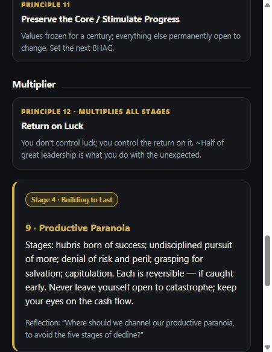

<p align="center"><strong>أَعُوذُ بِاللَّهِ مِنَ الشَّيْطَانِ الرَّجِيمِ</strong><br>
<em>Auzubillah Minashaitan Nirajeem — “I seek refuge in Allah from the outcast Shaitan (Satan).”</em></p>

<p align="center"><strong>بِسْمِ اللَّهِ الرَّحْمَنِ الرَّحِيمِ</strong><br>
<em>Bismillahir Rahmanir Rahim — “In the name of Allah, the Most Gracious, the Most Merciful.”</em></p>

---

# BE 2.0 — Framework & Operating System for an Enduring Great Company

*Built from **Beyond Entrepreneurship 2.0** by Jim Collins and Bill Lazier (2020) and the wider Collins research canon (Built to Last, Good to Great, How the Mighty Fall, Great by Choice, Turning the Flywheel) — for the owner-founder of a small or mid-sized company who intends to build something that matters and lasts.*

**The question this system answers:** *"How do I turn the company I already have into an enduring great company?"*

---

## What's in this folder

| File | What it is | When you use it |
| --- | --- | --- |
| `README.md` | This hub: the map, the quick start, the ground rules | Start here |
| `01-framework.md` | **The Framework** — what "great" means, the 12-principle path (The Map), and the six operating areas from BE 2.0 in depth | Read once fully; return to the section you're working on |
| `02-system.md` | **The System** — the operating routines that keep it alive: annual reset, quarterly advance, monthly truths, weekly focus; decisions, people, communication, metrics, mechanisms | Install the rhythms after your first diagnostic |
| `03-tools.md` | **The Toolbox** — every worksheet the system uses: scorecard, key-seat audit, vision builder, strategy one-pager, march tracker, after-action review, meeting agendas | Print what you need; fill it in with your team |
| `barakah.md` | **The Islamic lens** — amanah, sidq, ihsan, shura, sabr, shukr and barakah mapped onto the system, with adab and duas for the build | Optional companion reading |
| `be-dashboard.html` | **Interactive dashboard** — framework map, self-assessment scorecard, the 12 reflection questions, key-seat calculator, priorities tracker, march tracker, after-action log. Saves locally in your browser | Open in any browser; use monthly/quarterly |
| `reference/` | Official Jim Collins tools (The Map: Twelve Questions; Vision Framework; Good to Great Diagnostic Tool) for your personal use, with copyright notices | The source tools behind this system |



---

## The whole system in one picture

```
                          WHAT GREAT MEANS  (outputs)
          Superior Results  ·  Distinctive Impact  ·  Lasting Endurance
                                       ▲
                                       │  multiplied by
                        ┌──────────────┴───────────────┐
                        │        RETURN ON LUCK        │
                        │  (you don't control luck;    │
                        │   you control the return)    │
                        └──────────────┬───────────────┘
                                       ▲
        ┌──────────────────────────────┴───────────────────────────────┐
        │                        THE PATH  (The Map)                   │
        │                                                              │
        │  1 · DISCIPLINED PEOPLE    2 · DISCIPLINED THOUGHT           │
        │      Level 5 Leadership       Genius of the AND              │
        │      First Who, Then What     Brutal Facts (Stockdale)       │
        │                               Hedgehog Concept              │
        │                                                              │
        │  3 · DISCIPLINED ACTION    4 · BUILDING TO LAST              │
        │      The Flywheel             Productive Paranoia            │
        │      20-Mile March            Clock Building                 │
        │      Bullets → Cannonballs    Preserve Core / Stimulate      │
        │                                 Progress (next BHAG)         │
        └──────────────────────────────┬───────────────────────────────┘
                                       ▲
                   Run through the six BE operating areas,
                   on a rhythm that never stops:
        Leadership style · People · Vision · Strategy · Innovation · Tactics
              ANNUAL reset → QUARTERLY advance → MONTHLY truths → WEEKLY focus
```

**The logic in one sentence:** a founder with the right people (Leadership, People) thinks clearly (Vision, Strategy, Innovation) and acts with relentless tactical discipline (Tactics) — turn by turn of the flywheel — until the company outlasts its founder.

---

## Quick start — your first 90 days

| Weeks | Do this | Where |
| --- | --- | --- |
| 1 | Read `01-framework.md`. Score yourself honestly in the Diagnostic tab of `be-dashboard.html` (or Tool 1). | Framework + Dashboard |
| 2–3 | Work through the **12 questions** (The Map), one per sitting — alone first, then with your leadership team, one per month after that. | Tool 2 / Dashboard |
| 4–5 | **Vision check:** core values (7 tests), purpose (7 tests), one BHAG (8 tests). You are not wordsmithing; you are choosing the mountain. | Tool 9 |
| 6–7 | **People:** key-seat audit. Name every key seat, mark the right person, compute your %. Target: 90%+. Use the develop-or-replace worksheet for any seat below standard. | Tools 6–7 |
| 8–10 | **Strategy one-pager:** max 5 priorities, one owner each, one page. Plus a stop-doing list. | Tool 10 |
| 11–12 | **Install the rhythm:** set your 20-mile march, write your SMaC recipe, define your dashboard numbers, hold your first weekly huddle and monthly truths session. | `02-system.md` |
| Then | The annual reset becomes the anchor of the year. Everything else is maintenance. | `02-system.md` § Annual |

---

## The five ideas that carry all the rest

1. **Greatness is a dynamic process, not an endpoint.** The moment you think you've arrived, the slide has begun.
2. **First who, then what.** Great vision without great people is irrelevant.
3. **Vision = core values (never change) + purpose (about a century) + a BHAG (10–25 years).**
4. **Freedom within a framework; manage the system, not the people.**
5. **Preserve the core / stimulate progress. Manage for the quarter century.**

---

## The Islamic lens

This system was written to be run by a founder whose character is the company’s first foundation. The virtues of the Islamic tradition map onto it almost one-to-one — the full companion is in **`barakah.md`**:

| Virtue | Where it lives in this system |
| --- | --- |
| **Amanah** — sacred trust | Core values; the Trust Wager; OPURs; key seats; building for a hundred years |
| **Sidq** — truthfulness | Confront the brutal facts; autopsies without blame; honest expectations in the storm |
| **Ihsan** — excellence as worship | Tactical excellence; values standards absolute; “good enough never is” |
| **Shura** — consultation | Vision and strategy set with the people who must carry them out |
| **Adl & Rahmah** — justice and mercy | Rigor, not ruthlessness; high standards with exits that keep dignity |
| **Sabr** — patience and perseverance | The 20-Mile March; ever forward; persist with the company, not one idea |
| **Shukr** — gratitude | The generosity flywheel; specific appreciation; “enough is enough” |
| **Barakah** — blessing that multiplies | Purpose beyond profit; generosity compounds beyond arithmetic |

## Ground rules

- **This is a personal, unofficial synthesis.** Framework names and concepts belong to their authors: *BE 2.0* © James C. Collins & William C. Lazier (1992; 2020); *The Map*, *Vision Framework*, and *Good to Great Diagnostic Tool* © Jim Collins, used for personal (intra-company) purposes with attribution. Keep the copyright notices intact in anything you copy from `reference/`.
- **This does not replace the book.** The fastest way to use this system well: read *BE 2.0*, especially chapters 2 (people), 3 (leadership style), 4 (vision), 6 (the Map), 7 (strategy), and 9 (tactical excellence) — and then keep the book within arm's reach.
- **Keep it small.** The system is deliberately short: 12 principles, 6 areas, 4 rhythms, 1 page of strategy, 5 priorities, 90% key seats. If it grows past what you can run in an hour a week, cut it back.

---

*Alhamdulillah — all praise belongs to Allah. May He place barakah in this work, in the company it serves, and in everyone who builds with it.*
